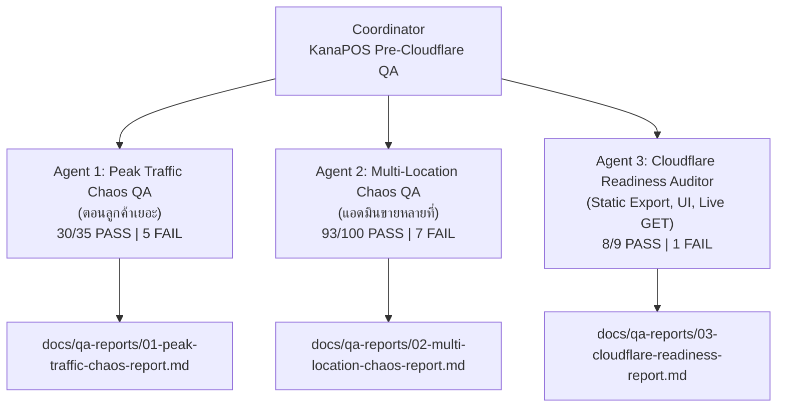

# 🚨 รายงานสรุปการทดสอบระบบ KanaPOS โดย AI QA Agents (ก่อนอัปขึ้น Cloudflare)

**วันที่ทดสอบ:** 21 พฤศจิกายน 2026  
**ขอบเขตระบบ:** KanaPOS v2 (Next.js 16 Static Export + Dexie IndexedDB v3 + Google Apps Script Web App)  
**สถานะความพร้อมก่อน Deploy Cloudflare:** ⚠️ **NO-GO / CONDITIONAL GO (พบจุดวิกฤต 5 จุดที่ควรแก้ก่อนเปิดใช้งานจริง)**  
**ความปลอดภัยข้อมูลจริง:** ✅ **ปลอดภัย 100%** (ทุกการทดสอบยิงจำลองใน Node `vm` Sandbox แยกต่างหาก และเช็กเซิร์ฟเวอร์จริงด้วย `GET` แบบอ่านอย่างเดียวเท่านั้น ไม่กระทบข้อมูลร้านจริง 15 สินค้า / 877 บิล / 26 รายจ่าย)

---

## 📊 ภาพรวมผลการทดสอบจาก AI Agents ทั้ง 3 ตัว

| AI Agent | บทบาทการทดสอบ | สคริปต์จำลอง | ผลทดสอบ | จุดวิกฤต (Critical) | ความเสี่ยงสูง (High) | ปานกลาง/ต่ำ | รายงานฉบับเต็ม |
| :--- | :--- | :--- | :---: | :---: | :---: | :---: | :--- |
| **Agent 1** | **Peak Traffic Chaos QA** (ลูกค้าเยอะ / แย่งสต็อก / เน็ตหลุด) | `tests/chaos/peak_traffic_simulation.mjs` | **30/35 PASS** (5 FAIL) | 4 | 5 | 6 | [01-peak-traffic-chaos-report.md](docs/qa-reports/01-peak-traffic-chaos-report.md) |
| **Agent 2** | **Multi-Location Chaos QA** (แอดมินขายหลายที่ / เที่ยงคืน / Data) | `tests/chaos/multi_location_simulation.mjs` | **93/100 PASS** (7 FAIL) | 1 | 1* | 9 | [02-multi-location-chaos-report.md](docs/qa-reports/02-multi-location-chaos-report.md) |
| **Agent 3** | **Cloudflare Readiness Auditor** (Bundle, Hydration, Dark/iPad, Live GET) | Read-Only Live Check + `out/` Audit | **8/9 PASS** (1 FAIL) | 0 | 1* | 6 | [03-cloudflare-readiness-report.md](docs/qa-reports/03-cloudflare-readiness-report.md) |

*\*หมายเหตุ: บั๊ก "Expense Sync Delete-Race / Millisecond Mismatch" ถูกตรวจพบตรงกันจากทั้ง 3 Agents อิสระ*

---

## 🔴 รายการจุดวิกฤต (CRITICAL — ต้องแก้ไขก่อนใช้งานจริง)

| รหัส | ปัญหาที่ตรวจพบ | สถานการณ์ที่จะพัง | ไฟล์และบรรทัดที่เกิดเหตุ |
| :---: | :--- | :--- | :--- |
| **CRIT-01** | **ลบบิลรายจ่ายข้ามทำเลพัง (`deleteExpense` ลบของร้านอื่นทิ้งหมด)** | แอดมินร้าน `ตลาด ก` ลบรายจ่าย `"ค่าน้ำแข็ง"` แล้วระบบไปลบ `"ค่าน้ำแข็ง"` ของร้าน `ตลาด ข` และทุกวันในชีตรวมทิ้งหมด (แถมใน `_ระบบ_รายจ่าย` ลบของร้าน ข แล้วเหลือของร้าน ก ค้างไว้) | `google-apps-script.js:1284-1290`, `1306-1328` |
| **CRIT-02** | **รายจ่ายหาย/ซ้ำ/ฟื้นคืนชีพทุก 30 วินาที (Expense Sync Race)** | `doGet` ตัดค่ามิลลิวินาที `createdAt` เป็น `.000` ทำให้ `cloudExpenseKeys` ไม่ตรงกับเครื่อง ทุกการซิงก์ 30 วิจึงยิง POST ซ้ำใส่ `_ระบบ_รายจ่าย`, ปลุกรายจ่ายที่ลบไปแล้ว, และลบรายจ่ายออฟไลน์ออกจากเครื่องทันทีโดยไม่มี Grace Period | `src/utils/googleSheetSync.ts:326-401`, `google-apps-script.js:718-730` |
| **CRIT-03** | **Error 429/500/503 จาก Google ถูกนับเป็น `success: true` ทำให้บิลหายถาวร** | ช่วงลูกค้าเยอะแล้ว Google Apps Script ตอบ HTTP 429/500/503 หรือหน้า HTML error ฟังก์ชัน `postToScriptWithResponse` หลุดไปคืน `{ success: true }` แล้วลบบิลออกจากคิว `kana_pending_orders_queue` ทิ้งทันที | `src/utils/googleSheetSync.ts:80-95` |
| **CRIT-04** | **ยกเลิกบิลซ้ำ (`deleteSingleOrder`) คืนสต็อกเบิ้ลไม่จำกัด** | หากเน็ตหน่วงแล้วกดยกเลิกบิลซ้ำ หรือ 2 เครื่องกดลบบิลเดียวกัน ระบบคืนสต็อกก่อนเช็กว่ามีบิลนั้นอยู่ในชีตจริงหรือไม่ ทำให้สต็อกงอกเกินจริง (`10 -> 12`) | `google-apps-script.js:1597-1721` |
| **CRIT-05** | **ช่องโหว่ข้าม `appToken` ใน `doPost` และไม่มีตรวจ Token ใน `doGet`** | หากยิง POST โดยไม่ส่งฟิลด์ `appToken` เงื่อนไข `if (postData.appToken && ...)` จะข้ามการตรวจไปเลย และ `doGet` เปิดอ่านข้อมูลยอดขาย/กำไร/รัน `format_template` โดยไม่ตรวจ Token | `google-apps-script.js:972`, `631-647` |

---

## 🟠 รายการความเสี่ยงสูง (HIGH — ควรแก้ก่อนช่วงขายจริงที่มีลูกค้าเยอะ)

| รหัส | ปัญหาที่ตรวจพบ | ผลกระทบ | ไฟล์และบรรทัด |
| :---: | :--- | :--- | :--- |
| **HIGH-01** | **$O(N^2)$ Full-Sheet Repaint ใน `ScriptLock`** | ทุกบิลขายทาสีพื้นหลังใหม่ทั้งชีตทั้ง 3 แผ่น (200 บิล = ทาสี **615,060 เซลล์**) ระหว่างถือ `ScriptLock` เสี่ยงเกิด `waitLock(30000)` Timeout เมื่อมีหลายเครื่องขายพร้อมกัน | `google-apps-script.js:176-213`, `491`, `556` |
| **HIGH-02** | **กดปุ่ม "บันทึกการขาย" รัว 2 ครั้ง (Double-Tap Race)** | `isSubmittingOrder` ใช้ `useState` แทน `useRef` หากแตะรัวในเฟรมเดียวกันบน iPhone/iPad จะสร้างบิลซ้ำ 2 ใบและตัดสต็อกเบิ้ล | `src/app/page.tsx:64`, `240-243` |
| **HIGH-03** | **คิวออฟไลน์ทิ้งบิล `OUT_OF_STOCK` แบบเงียบ** | เมื่อ `flushPendingOrders` เจอ `OUT_OF_STOCK` จะลบบิลออกจากคิวโดยไม่ลบบิลผีออกจาก `db.orders` และไม่คืนสต็อกในเครื่องหรือแจ้งแคชเชียร์ | `src/utils/googleSheetSync.ts:493-495`, `src/app/page.tsx:323-334` |
| **HIGH-04** | **บิลเดียวที่มีบาร์โค้ดซ้ำกันหลายแถวขายเกินสต็อกได้** | ขั้นตอนตรวจสต็อกใน `saveOrder` ตรวจทีละบรรทัดโดยไม่รวมจำนวนของบาร์โค้ดเดียวกันก่อน (`qty 2 + qty 2 > stock 3` ผ่านได้) | `google-apps-script.js:1037-1083` |
| **HIGH-05** | **ลบบิลที่มีทั้งสินค้ามีบาร์โค้ดและไม่มีบาร์โค้ด คืนสต็อกไม่ครบ** | `if (!restockedAny)` ข้ามการคืนสต็อกสินค้าที่ไม่มีบาร์โค้ดทันทีถ้ามีสินค้าอื่นคืนไปแล้ว | `google-apps-script.js:1603-1652` |

---

## 🟡 รายการความเสี่ยงปานกลาง & ต่ำ (MEDIUM / LOW)

1. **ส่วนลดสินค้ารายชิ้นเพี้ยนเมื่อซิงก์ข้ามเครื่อง (`google-apps-script.js:522-524, 765-791`):** `doGet` อ่านราคาหลังลด `@ 50 [ลด 5]` กลับไปเป็น `price=50, discount=5` แทนที่จะคืนราคาเต็ม `55`
2. **Formula Injection เมื่อมีช่องว่างนำหน้าใน `_ระบบ_รายจ่าย` (`google-apps-script.js:1254`):** ไม่ได้ `.trim()` `exp.location` ก่อนส่งเข้า `sanitizeForSheet` ทำให้ `"  =SUM(A1)  "` หลุดรอด
3. **Top Products แตกเป็น 2 แถวใน Analytics (`src/utils/dataAnalytics.ts:305`):** บิลที่มีบาร์โค้ดกับบิลเก่าที่มีแค่ชื่อสินค้าไม่ถูกรวมกันแม้จับคู่ `matchedProd` เจอแล้ว
4. **เรียง Top Products ตามยอดขายใน `AnalyticsModal` อาจตกหล่น (`src/utils/dataAnalytics.ts:337-339`, `src/components/AnalyticsModal.tsx:57-63`):** ตัด `.slice(0, 10)` ตามจำนวนชิ้นก่อน แล้วค่อยเรียงตามยอดขายทีหลัง
5. **`migrateLegacyExpensesToOrderSheets` ทิ้งคอลัมน์ `location` (`google-apps-script.js:326-345`):** ไม่ได้อ่าน `erow[7]`
6. **IndexedDB ซิงก์ทีละแถวไม่ได้ทำ Batch (`src/utils/googleSheetSync.ts:252-319`):** กับ 877 บิลจริง จะยิง transaction ย่อย ~1,754 ครั้งทุก 30 วินาที (ประกอบกับเวลาโหลด GET เฉลี่ย 4.108 วินาที / 330.23 KB)
7. **ตะกร้าค้างอ้างอิง `product.id` แทน `barcode` (`src/app/page.tsx:248`):** หากซิงก์แล้วรีเซ็ต `id` อาจขึ้นเตือนผิดว่าสินค้าถูกลบ
8. **Product Mutations ไม่มีคิวออฟไลน์ (`src/app/products/page.tsx:115, 173`, `src/utils/googleSheetSync.ts:222-227`):** สินค้าที่เพิ่มตอนออฟไลน์จะถูกลบทิ้งเมื่อซิงก์หาก POST แรกไม่สำเร็จ
9. **UX/UI เล็กน้อย:** `alert`/`confirm`/`prompt` 25 จุดบน iOS PWA, ปุ่ม `-`/`+` บนการ์ด POS ขนาด 28px/36px, บางปุ่มรองยังไม่มี `dark:hover:`, และ `wrangler.json:6` ตั้ง `not_found_handling: "single-page-application"` บดบัง `out/404.html`

---

## ✅ สิ่งที่ผ่านการทดสอบอย่างแข็งแกร่งแล้ว

- **Cloudflare Static Export (`out/` + `wrangler.json`):** ผ่าน 100% — สร้างครบทั้ง 4 เส้นทาง (`/`, `/data/`, `/products/`, `/settings/`) + `404.html`, ขนาดรวม ~1.56 MB, ไม่มี redirect loop
- **Last-Item Stock Stampede (20 เครื่องแย่งของ 3 ชิ้น):** ผ่าน 100% — ขายได้พอดี 3 ชิ้น, อีก 17 เครื่องโดนปฏิเสธ `OUT_OF_STOCK`, สต็อกจบที่ `0` ไม่มีติดลบ
- **Duplicate Order Idempotency (ยิงบิลซ้ำ 10 รอบ):** ผ่าน 100% — ตัดสต็อกครั้งเดียว อีก 9 รอบคืน `duplicate: true`
- **Multi-Location Separation & Midnight `00:00` Reset:** ผ่าน 100% — 6 แอดมินขายพร้อมกัน 4 ทำเล + 2 ไม่ระบุทำเล แยกการ์ดรายวัน/รายเดือนและเรียงลำดับภาษาไทยถูกต้อง รวมกลุ่มไม่ระบุทำเลถูกต้อง ล้างค่าเที่ยงคืนเฉพาะเครื่องถูกต้อง และคำนวณไทยช่วยไทย 100%/40% (BS-08) ถูกต้อง
- **IndexedDB v1 → v2 → v3 Upgrade & SSR Hydration:** ผ่าน 100% — ไม่มีข้อมูลผู้ใช้เก่าหาย ไม่มี Hydration Mismatch
- **Live Apps Script Endpoint (Read-Only GET × 3):** ผ่าน 100% — HTTP 200 ทั้ง 3 รอบ, เวลาเฉลี่ย `4,108 ms`, ข้อมูลจริง 15 สินค้า / 877 บิล / 26 รายจ่าย สมบูรณ์ 100%

---

## 🎯 คำแนะนำลำดับการแก้ไขก่อนอัปลง Cloudflare

1. **รอบเร่งด่วน (Must-Fix ก่อน Deploy):** แก้ **CRIT-01 ถึง CRIT-05** และ **HIGH-01 ถึง HIGH-05** (แก้ใน `google-apps-script.js`, `src/utils/googleSheetSync.ts`, `src/app/page.tsx`) แล้วรัน `tests/chaos/peak_traffic_simulation.mjs` + `tests/chaos/multi_location_simulation.mjs` ซ้ำจนผ่าน 100%
2. **รอบเสริมความเสถียร (Should-Fix):** แก้ปัญหา **MEDIUM** (Analytics `pKey` + Top 10 revenue sort, `exp.location.trim()`, `doGet` discount price, และ Dexie `bulkPut` transaction batching)
3. **Deploy:** กด Deploy New Version ใน Google Apps Script -> รัน `npm run build` -> อัปโหลด `out/` ขึ้น Cloudflare Workers/Pages ครับ
